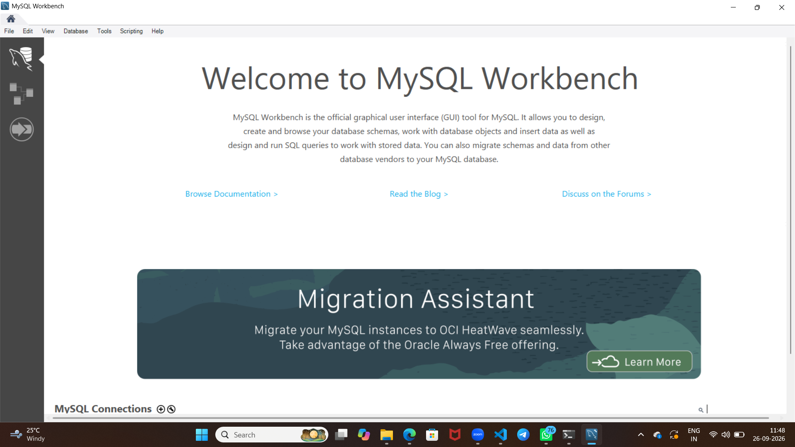

Tasks
1.Install MySQL Community Server on your computer and take a screenshot of the MySQL installer completion window.

2.Open MySQL Workbench or DB Browser, connect to your local MySQL server, and create a new database called music_streaming_db.

3.Write the SQL command to create a new database named food_delivery_db and execute it in your SQL Workbench or DB Browser.<br><br><em><strong>Hint:</strong> Use the CREATE DATABASE statement.</em>

4.List 3 differences between MySQL and PostgreSQL in terms of features or use cases, and give one example of a popular app or company that uses each.

**SOLUTION**

INSTALL MYSQL SERVER

LINK
```
https://dev.mysql.com/downloads/file/?id=551515
```


2.  CREATE A DATABASE called music_streaming_db

**syntax**
```
create database music_streaming_db
```


3. **sql command**
 **syntax**
 ```
 create database food_delivery_db
 ```


 4. 

MySQL and PostgreSQL are both popular relational databases, but they differ in features and typical use cases:

1. Data types and advanced features: PostgreSQL supports more advanced features such as JSONB, array types, full-text search, and complex queries, making it stronger for analytical and enterprise applications. MySQL is simpler and widely used for web apps and general-purpose storage.

2. Performance and scalability: MySQL is often preferred for fast read-heavy web applications and simple transactional systems. PostgreSQL is often chosen for complex applications requiring strong data integrity, advanced indexing, and large-scale analytics.

3. Licensing and ecosystem: MySQL is very common in web development and cloud-based apps, while PostgreSQL is popular in enterprise, data-heavy, and standards-oriented systems.

Examples:
- MySQL: Facebook uses MySQL for large-scale social media data storage and web services.
- PostgreSQL: Instagram uses PostgreSQL for core application data and complex querying.

Short answer: MySQL is commonly used for fast, scalable web applications, while PostgreSQL is preferred for advanced features, analytics, and complex enterprise workloads.
