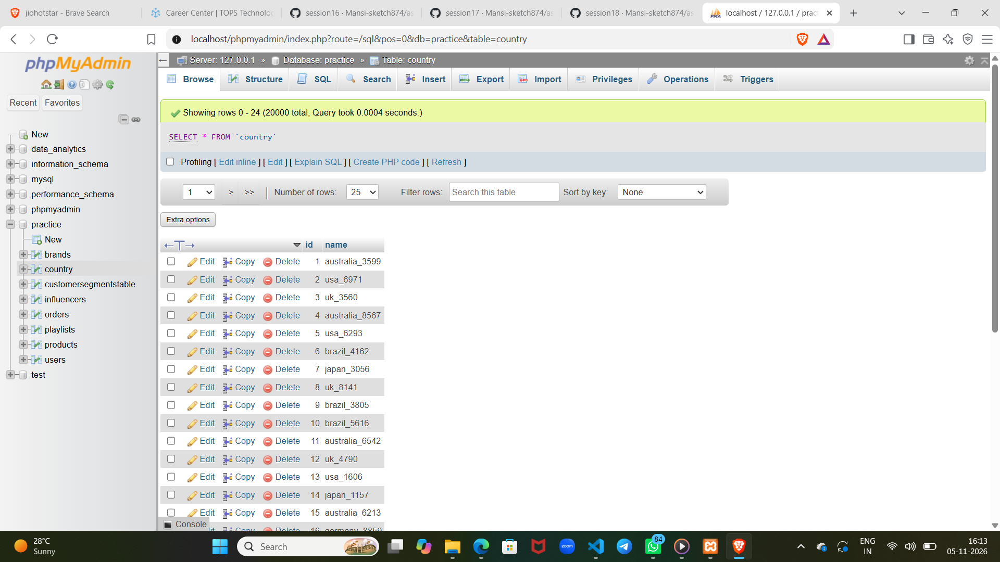
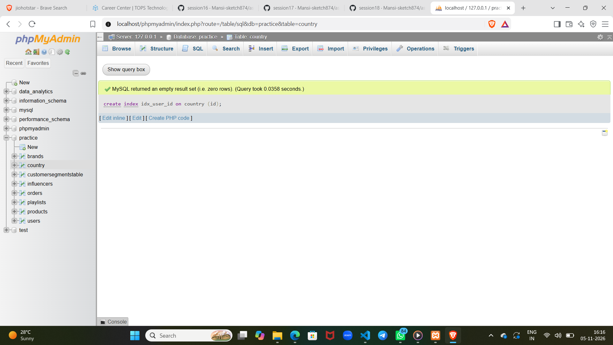

1.
Run a SELECT query on a large 'orders' table (at least 10,000 rows) to find all orders for a specific user_id and measure the query execution time.
2.
Create an index on the user_id column of the 'orders' table and re-run the same SELECT query to measure the new execution time.  <em><strong>Hint:</strong> Use CREATE INDEX idx_user_id ON orders(user_id); and compare the times before and after.</em>
3.
Use the EXPLAIN PLAN command to analyze how your SELECT query runs before and after adding the index, and write down the key differences you observe in the output.
4.
Write a query for a 'products' table that avoids a full table scan by using an index on the 'category' column to fetch all products in a specific category.
5.
Suppose your SELECT query on the 'orders' table is still slow even after adding an index. Use EXPLAIN PLAN and research at least one more optimization technique (other than indexing) using an AI tool like ChatGPT or Copilot, and describe how you would apply it.

1.  

2. 

3. 

4. SELECT *
FROM products
WHERE category = 'Electronics';

5. Optimization technique: retrieve only the columns you need
If the application does not need every column, replace SELECT * with an explicit column list. This reduces data read and transferred, especially when orders contains large text or JSON fields.

-- Plan for the original query
EXPLAIN
SELECT *
FROM orders
WHERE user_id = 123;

-- Plan for the narrower query
EXPLAIN
SELECT order_id, order_date, total_amount
FROM orders
WHERE user_id = 123;

. Use EXPLAIN ANALYZE where supported to see actual execution details, since plain EXPLAIN generally reports estimates. Keep the same WHERE condition so the optimization does not change which orders are returned.

This is a projection-reduction technique, researched with an AI assistant such as Copilot; it is separate from adding an index.

