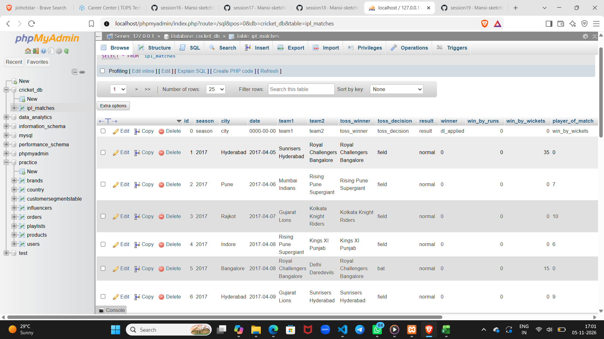
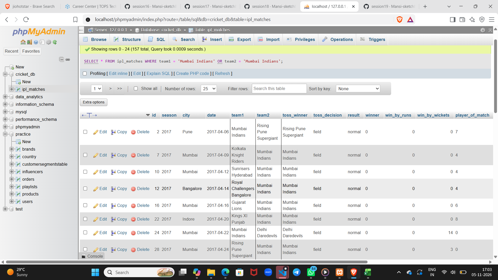

Tasks
1.

2.
Write a SQL query to select all matches where the team 'Mumbai Indians' played, then export the query results as a CSV file named mi_matches.csv.
3.
Connect Microsoft Excel to your SQL database and import the ipl_matches table. Create a simple table in Excel that shows the total matches played by each team.
4.
Connect Power BI Desktop to your SQL database, import the ipl_matches table, and create a pivot chart showing the number of wins for each team.
5.
Use Python (with pandas and sqlalchemy) to read the mi_matches.csv file, filter matches where 'Mumbai Indians' won, and insert those rows into a new SQL table called mi_wins.  <em><strong>Hint:</strong> Use pandas.read_csv(), DataFrame filtering, and to_sql() for this task.</em>

1. 

2. 

3. 